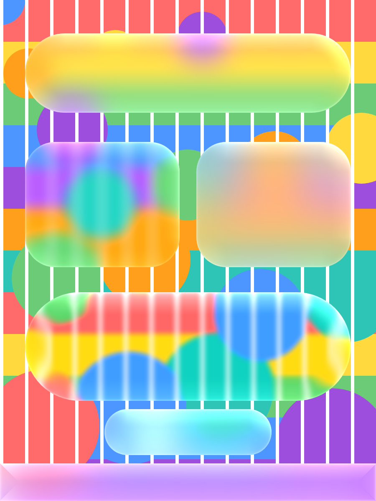
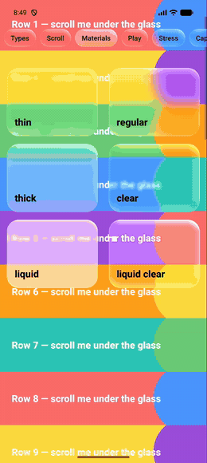
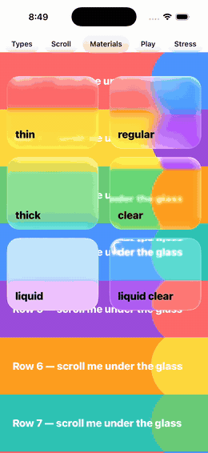

# react-native-liquid-glass-native

Liquid Glass surfaces for React Native, Expo and the web: real, live background blur with edge refraction, rim lighting and touch response.

- **Android is first-class.** GPU blur and an AGSL refraction shader on Android 13+, GPU blur on Android 12, and an automatic snapshot fallback on Android 7–11.
- **iOS uses the system by default.** iOS 26+ gets Apple's own `UIGlassEffect`; iOS 15–25 gets native materials. `iosRenderer="shader"` switches to the library's Metal renderer to match Android.
- **Expo works.** Expo dev builds and EAS builds get the full native glass. No config plugin needed.
- **Web works.** React, Vite, Next.js (with server-side rendering) and Expo web get glass through CSS `backdrop-filter`.
- **One API everywhere.** You write `<LiquidGlassView>` and the library picks the best renderer for each device.

```tsx
import { GlassBackdrop, LiquidGlassView } from 'react-native-liquid-glass-native';

<View style={{ flex: 1 }}>
  <GlassBackdrop style={StyleSheet.absoluteFill}>
    <ScrollView>{/* photos, lists, gradients… */}</ScrollView>
  </GlassBackdrop>

  <LiquidGlassView material="regular" style={{ position: 'absolute', top: 60, left: 16, right: 16, padding: 16 }}>
    <Text>Hello, glass</Text>
  </LiquidGlassView>
</View>
```



*Rendered by the library's own shader pipeline through Skia (`npm run preview:shader`): regular, thin, thick, clear (refraction + RGB split) and a pressed pill with touch light. This is the Android and `<FrostedGlass>` look; default iOS glass is Apple's own and looks different.*

## See it running

Real recordings of the example app. The Android and iOS demos run the same script with `iosRenderer: 'shader'` set in the theme. Click a preview for the full video.

| Android | iOS |
|---|---|
| [](https://raw.githubusercontent.com/SachinMeenaSipl/react-native-glass-effect/v0.2.0/docs/videos/glass-demo-android.mp4) | [](https://raw.githubusercontent.com/SachinMeenaSipl/react-native-glass-effect/v0.2.0/docs/videos/glass-demo-ios.mp4) |

## Install

```sh
npm install react-native-liquid-glass-native
cd ios && pod install
```

Then rebuild the app. It works in any app on the New Architecture (the default since RN 0.76).

### Expo

```sh
npx expo install react-native-liquid-glass-native
npx expo run:android   # or: npx expo run:ios
```

Works in Expo dev builds and EAS builds. **Expo Go can't load third-party native code**, so there the components fall back to a plain tinted view instead of crashing.

### Web

```sh
npm install react-native-liquid-glass-native react-native-web react-dom
```

Alias `react-native` to `react-native-web` in your bundler. Step-by-step setup: [Vite](https://sachinmeenasipl.github.io/react-native-glass-effect/installation/web), [Next.js](https://sachinmeenasipl.github.io/react-native-glass-effect/installation/nextjs), [Expo web](https://sachinmeenasipl.github.io/react-native-glass-effect/installation/expo#expo-web).

## The one rule

> Put what the glass should blur inside a **`<GlassBackdrop>`**. Render the glass **next to it, on top**, never inside it.

```
<View>                       ← screen
 ├─ <GlassBackdrop>          ← background layer: images, lists, video
 │    └─ …content…
 └─ <LiquidGlassView>        ← glass layer: headers, buttons, cards, tab bars
```

iOS doesn't need the backdrop, but keeping it makes the same code work on both platforms.

## What you get on each device

| Device | Renderer | Blur | Refraction | Rim light | Touch light / squish |
|---|---|---|---|---|---|
| Android 13+ | `shader` | ✅ live, GPU | ✅ | ✅ shader | ✅ |
| Android 12 | `blur` | ✅ live, GPU | — | ✅ approximated | ✅ |
| Android 7–11 | `compat` | ✅ snapshot, throttled | — | ✅ approximated | ✅ |
| iOS 26+ | `system-glass` | ✅ system | ✅ system | ✅ system | ✅ system |
| iOS 15–25 | `system-material` | ✅ system | — | ✅ approximated | JS scale |
| Web (React, Vite, Next.js, Expo web) | `fallback` | ✅ CSS `backdrop-filter` | — | — | — |
| Expo Go / tests | `fallback` | — (plain tinted view) | — | — | — |

Expo dev builds use the Android and iOS renderers above.

## Components

| Component | Use it for |
|---|---|
| `LiquidGlass` | Apple-style Liquid Glass on Android and iOS. |
| `FrostedGlass` | The library's own glass, drawn the same way on Android and iOS. |
| `GlassAdjuster` | Ready-made panel to tune glass live. |
| `LiquidGlassView` | Any glass surface. Everything else is built from it. |
| `GlassBackdrop` | Wraps the content that glass should see through. |
| `LiquidGlassButton` | Pill button with press feedback. |
| `LiquidGlassCard` | Padded glass container. |
| `GlassThemeProvider` | App-wide defaults (material, quality, radius, overrides). |

## Examples

| Folder | Shows |
|---|---|
| [`example/`](example) | React Native CLI app for Android and iOS: every renderer path |
| [`examples/liquid-glass-expo/`](examples/liquid-glass-expo) | Expo app: Android, iOS and Expo web |
| [`examples/web-vite/`](examples/web-vite) | React web app with Vite |
| [`examples/next-app/`](examples/next-app) | Next.js app with server-side rendering |

## Documentation

| For | Read |
|---|---|
| App developers | **[Documentation site](https://sachinmeenasipl.github.io/react-native-glass-effect/)**: installation guides, every component with live previews, recipes, API reference ([source](docs)) |
| Expo and web apps | Installation guides for [Expo](https://sachinmeenasipl.github.io/react-native-glass-effect/installation/expo), [Vite](https://sachinmeenasipl.github.io/react-native-glass-effect/installation/web) and [Next.js](https://sachinmeenasipl.github.io/react-native-glass-effect/installation/nextjs) |
| Contributors and AI agents | [AGENTS.md](AGENTS.md) and [architecture docs](docs/architecture/README.md) |
| Every edge case and how it's handled | [docs/architecture/05-edge-cases.md](docs/architecture/05-edge-cases.md) |

## License

MIT
