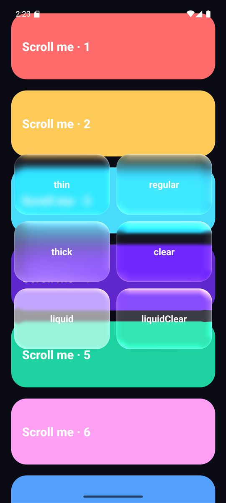
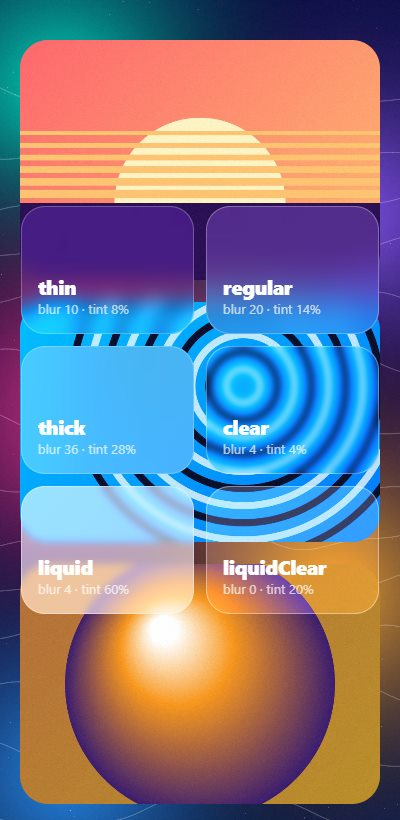
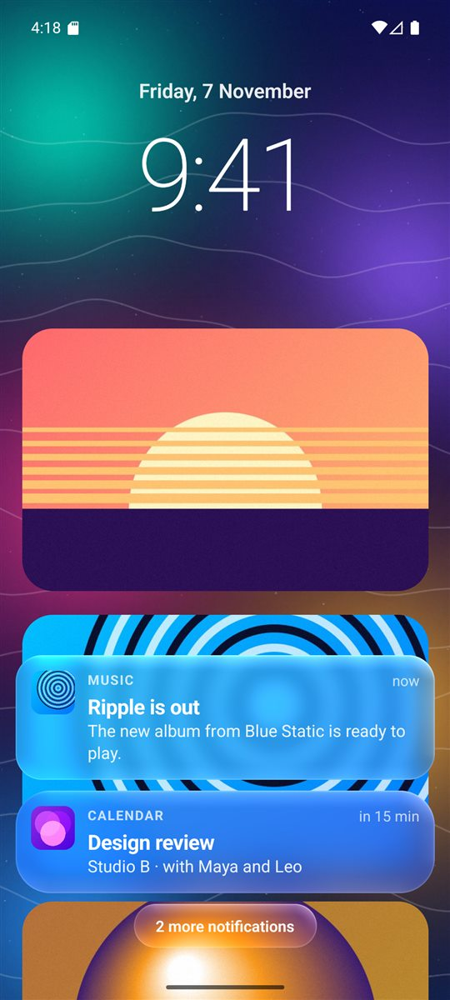
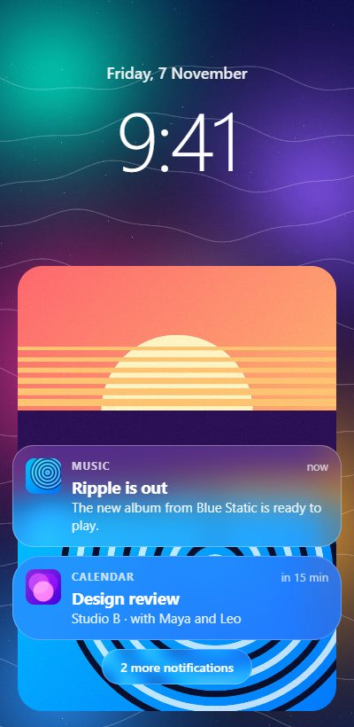
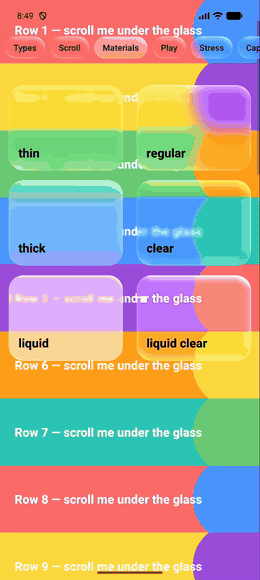
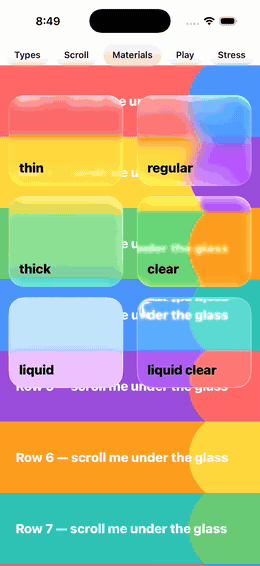

# Platform support

What each platform draws. For minimum versions and what has been tested, see [Compatibility](/reference/compatibility). The status labels are explained in the [Glossary](/reference/glossary#support-status-labels).

## Feature matrix

| Feature | Android 13+ | Android 12 | Android 7–11 | iOS 26+ | iOS 15–25 | Web | Expo Go |
|---|---|---|---|---|---|---|---|
| Live background blur | ✅ GPU | ✅ GPU | ✅ snapshot (throttled) | ✅ system | ✅ system | ✅ CSS | — |
| Edge refraction / lens | ✅ | — | — | ✅ system | — | — | — |
| RGB split at edges | ✅ (`high`) | — | — | — | — | — | — |
| Rim lighting | ✅ shader | ✅ approx. | ✅ approx. | ✅ system | ✅ sheen | — | — |
| Touch-follow light | ✅ | ✅ | ✅ | ✅ system (`interactive`) | — | — | — |
| Press squish | ✅ native | ✅ native | ✅ native | ✅ system | ✅ JS | ✅ JS | ✅ JS |
| Tilt lighting | ✅ | ✅ | ✅ | — | — | — | — |
| Animated prop changes | ✅ | ✅ | ✅ | ✅ effect | ✅ effect | — | — |
| Needs `<GlassBackdrop>` | yes | yes | yes | no (yes with `iosRenderer="shader"`) | no (yes with `iosRenderer="shader"`) | no | no |
| Video/maps in TextureView | ✅ | ✅ | — | ✅ | ✅ | — | — |
| Video/maps in SurfaceView | — | — | — | n/a | n/a | — | — |

"—" means the prop is accepted and ignored, never an error. The iOS columns are for the default `iosRenderer="system"`. With `iosRenderer="shader"`, iOS behaves like Android 13+.

**Expo dev builds** use the Android and iOS columns. **Web** covers React (Vite), Next.js (including server rendering) and Expo web.

## Requirements

| | Minimum |
|---|---|
| React Native | 0.76, New Architecture |
| Android | minSdk 24 (Android 7) |
| iOS | 15.1. Apple's Liquid Glass needs iOS 26, built with Xcode 26 |
| Web | `react-native-web` 0.19+ and a browser with `backdrop-filter` for blur |

## Tested setups

| Setup | Versions | Checked |
|---|---|---|
| Expo dev build, Android emulator | Expo SDK 58, React Native 0.88 | Every example on this site renders natively; buttons and the adjuster respond to taps |
| Expo web | Expo SDK 58, react-native-web 0.21 | Dev server and production export render; buttons work; no console errors |
| Vite | Vite 8, React 19, react-native-web 0.21 | Every example on this site renders; no console errors |
| Next.js | Next.js 16 (App Router, Turbopack) | `next build` prerenders; the browser hydrates; buttons work |

Not yet tested: iOS devices and simulators in these setups, EAS Build, Expo Go beyond the fallback.

## Side by side

The same example screens, captured on an Android emulator (native shader renderer) and in a browser (CSS renderer):

| Screen | Android | Web |
|---|---|---|
| Materials |  |  |
| Lock screen |  |  |

On Android the rim of each panel bends the artwork behind it (refraction). The browser draws the blur and tint only.

iOS captures aren't available yet: they need a Mac with a simulator or an iPhone.

## Why platforms look different

By default iOS uses Apple's own glass and Android uses the library's renderer, so they look clearly different: Apple's glass is lighter and paler. For a matching look:

- Use [`<FrostedGlass>`](/components/frosted-glass): the same shader on both.
- Use [`<LiquidGlass>`](/components/liquid-glass): Android tuned to match Apple's glass.
- Or tune per platform:

```tsx
<LiquidGlassView blur={Platform.OS === 'android' ? 24 : 20} />
```

## Recordings

Recordings of the example app with `iosRenderer: 'shader'` in the theme, so both platforms use the same renderer:

| Android | iOS |
|---|---|
| [](https://raw.githubusercontent.com/SachinMeenaSipl/react-native-glass-effect/v0.2.0/docs/videos/glass-demo-android.mp4) | [](https://raw.githubusercontent.com/SachinMeenaSipl/react-native-glass-effect/v0.2.0/docs/videos/glass-demo-ios.mp4) |
